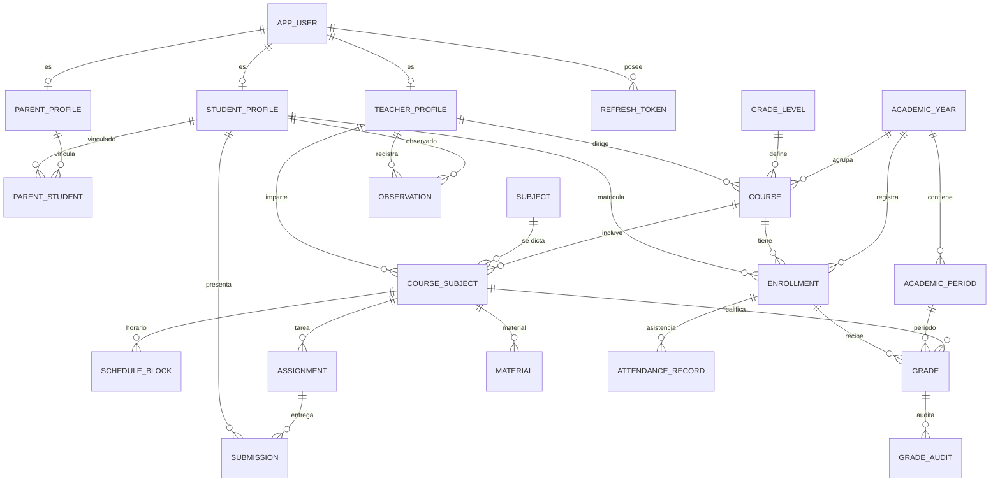
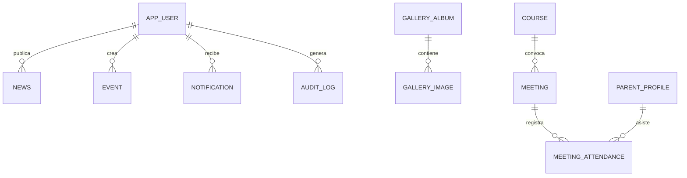

# Arquitectura — Portal Escolar

Documento de diseño técnico. Versión 0.1 (Fase 2). Sujeto a aprobación antes de implementar.

---

## 1. Visión general

Aplicación web de tres capas con frontend SPA y backend API REST sin estado de sesión en servidor
(autenticación por tokens). Un único repositorio (monorepo) con dos proyectos independientes que se
comunican por HTTP/JSON.

```text
┌──────────────────────────────┐
│  Navegador (PC / tablet /    │
│  móvil)                      │
│  React 19 + Vite 8           │
│  React Router 7              │
└──────────────┬───────────────┘
               │ HTTPS · JSON · JWT Bearer
               ▼
┌──────────────────────────────┐
│  API REST · Spring Boot 4    │
│  ├─ Spring Security (JWT)    │
│  ├─ Validación (Bean Valid.) │
│  ├─ Servicios de dominio     │
│  ├─ Repositorios (JPA)       │
│  └─ Auditoría                │
└──────────────┬───────────────┘
               │ JDBC · Flyway
               ▼
┌──────────────────────────────┐
│  PostgreSQL 18               │
│  Esquema `portal`            │
└──────────────────────────────┘
```

### Decisiones de arquitectura

| # | Decisión | Motivo | Alternativa descartada |
|---|----------|--------|------------------------|
| A1 | Monorepo `frontend/` + `backend/` | Un solo historial y despliegue coordinado; el equipo trabaja en ambos. | Repos separados (más fricción para un equipo pequeño). |
| A2 | API REST versionada en `/api/v1` | Contrato estable y evolución controlada. | GraphQL (sobreingeniería para el alcance). |
| A3 | JWT de acceso corto + refresh token rotativo en cookie `HttpOnly` | El access token vive en memoria (no en `localStorage`), reduciendo robo por XSS; el refresh viaja en cookie inaccesible a JS. | Sesión en servidor (requiere sticky sessions y complica el despliegue); JWT en `localStorage` (riesgo XSS). |
| A4 | BCrypt strength 12 | Estándar probado, incluido en Spring Security, sin dependencias extra. | Argon2id (mejor, pero requiere BouncyCastle; se puede migrar después). |
| A5 | Autorización por rol **y** por recurso en el backend | El rol no basta: un padre solo ve a *sus* hijos; un docente solo *sus* cursos. | Solo `@PreAuthorize` por rol (insuficiente). |
| A6 | Flyway para el esquema | Migraciones versionadas y reproducibles; nada de `ddl-auto=update` en producción. | Hibernate `ddl-auto` (no auditable). |
| A7 | UUID como clave primaria | IDs no enumerables en URLs y APIs; facilita integraciones. | `BIGSERIAL` (más simple, pero expone conteos). |
| A8 | Diseño con tokens CSS (`--color-*`, `--font-*`) | Permite cambiar escudo y colores oficiales sin tocar componentes. | Colores hardcodeados. |
| A9 | Frontend compilado y servido por Spring Boot en producción | Un solo artefacto y un solo origen (sin CORS en producción). | CDN/hosting separado (válido, se documentará como opción). |
| A10 | Spring Boot 4.1.x estable sobre Java 21 | Versión estable actual; Java 21 LTS. | Spring Boot 3.5.x (soporte anterior, plan B si hay incompatibilidades). |

---

## 2. Backend

### 2.1 Paquete base y capas

Paquete base: `com.portal.escolar` (provisional; se renombra cuando se defina el colegio).

```text
backend/
├─ .mvn/wrapper/
├─ mvnw
├─ mvnw.cmd
├─ pom.xml
└─ src/
   ├─ main/
   │  ├─ java/com/portal/escolar/
   │  │  ├─ PortalEscolarApplication.java
   │  │  ├─ config/          # Security, CORS, OpenAPI, Jackson, auditoría JPA, propiedades
   │  │  ├─ controllers/     # Un controlador por recurso y por rol
   │  │  │  ├─ publicapi/    # /api/v1/public/**
   │  │  │  ├─ auth/         # /api/v1/auth/**
   │  │  │  ├─ student/      # /api/v1/student/**
   │  │  │  ├─ teacher/      # /api/v1/teacher/**
   │  │  │  ├─ parent/       # /api/v1/parent/**
   │  │  │  └─ admin/        # /api/v1/admin/**
   │  │  ├─ services/        # Interfaces + implementaciones por dominio
   │  │  │  ├─ auth/
   │  │  │  ├─ academic/
   │  │  │  ├─ people/
   │  │  │  ├─ content/
   │  │  │  ├─ communication/
   │  │  │  └─ reporting/
   │  │  ├─ repositories/    # Spring Data JPA
   │  │  ├─ entities/        # Entidades JPA (una por tabla)
   │  │  ├─ dto/
   │  │  │  ├─ request/
   │  │  │  ├─ response/
   │  │  │  └─ mapper/       # Mapeo entidad <-> DTO (manual, sin exponer entidades)
   │  │  ├─ security/        # JwtService, JwtAuthenticationFilter, UserPrincipal,
   │  │  │                   # CustomUserDetailsService, AccessGuard (reglas por recurso)
   │  │  ├─ exceptions/      # Excepciones de dominio + @RestControllerAdvice
   │  │  ├─ audit/           # Registro de cambios sensibles
   │  │  ├─ validation/      # Validadores personalizados
   │  │  └─ util/
   │  └─ resources/
   │     ├─ application.yml
   │     ├─ application-dev.yml
   │     ├─ db/migration/    # V1__esquema_inicial.sql, V2__datos_demo.sql, ...
   │     └─ static/          # Build del frontend en producción
   └─ test/java/com/portal/escolar/
      ├─ unit/
      ├─ integration/
      └─ security/
```

### 2.2 Reglas de dependencia

```text
Controller → Service → Repository → Entity
     │           │
     └───────────┴──→ DTO / Mapper / Exceptions
```

- Los controladores **no** acceden a repositorios ni a entidades directamente.
- Las entidades JPA **nunca** se serializan como respuesta HTTP.
- Las reglas de negocio (promedios, matrícula, permisos por recurso) viven en `services/`.
- La seguridad por recurso se implementa en el servicio (`AccessGuard`), no en el controlador.

### 2.3 Manejo de errores

Formato único basado en `ProblemDetail` (RFC 9457):

```json
{
  "type": "https://portal.escolar/errors/validation",
  "title": "Datos inválidos",
  "status": 400,
  "detail": "La fecha de entrega no puede ser anterior a hoy.",
  "instance": "/api/v1/teacher/assignments",
  "errors": [{ "field": "dueAt", "message": "debe ser futura" }]
}
```

- 400 validación, 401 no autenticado, 403 sin permiso, 404 no encontrado, 409 conflicto,
  422 regla de negocio, 429 límite de intentos, 500 error interno (sin filtrar detalles).
- No se devuelven trazas ni nombres de tablas al cliente.

### 2.4 Validación

- Bean Validation en DTO de entrada (`@NotBlank`, `@Email`, `@Size`, `@Past`, `@Positive`, etc.).
- Validadores personalizados para: documento, teléfono, rango de nota según escala, fecha dentro
  del periodo, archivo permitido.
- Validación de reglas de negocio en el servicio (por ejemplo: nota ≤ puntaje máximo de la tarea,
  matrícula única por año, docente asignado al curso).

### 2.5 Auditoría

- `audit_log`: acciones administrativas y de seguridad.
- `grade_audit`: cada creación/modificación/anulación de calificación guarda valor anterior, nuevo,
  usuario, motivo, fecha e IP.
- `@CreatedDate`, `@LastModifiedDate`, `@CreatedBy`, `@LastModifiedBy` vía auditoría JPA.
- Las calificaciones no se borran físicamente: se anulan o corrigen dejando rastro.

---

## 3. Modelo de datos

Base de datos PostgreSQL 18, esquema `portal`, migraciones Flyway. Convención: tablas en
`snake_case`, claves `uuid` generadas en la aplicación, `created_at`/`updated_at` en todas las
tablas mutables y `version` para bloqueo optimista en entidades editables.

### 3.1 Diagrama entidad-relación (núcleo)



### 3.2 Diagrama entidad-relación (comunicación y contenido)



### 3.3 Entidades y campos principales

#### Identidad y acceso

| Tabla | Campos clave | Restricciones |
|-------|--------------|---------------|
| `app_user` | `id`, `email`, `password_hash`, `first_name`, `last_name`, `role`, `enabled`, `must_change_password`, `last_login_at`, `created_at`, `updated_at`, `version` | `email` único (sin distinguir mayúsculas) |
| `student_profile` | `id`, `user_id`, `document_type`, `document_number`, `birth_date`, `gender`, `address`, `phone`, `photo_url`, `status`, `admission_date` | `user_id` único; `document_number` único |
| `teacher_profile` | `id`, `user_id`, `employee_code`, `hire_date`, `specialty`, `phone`, `bio` | `user_id` único; `employee_code` único |
| `parent_profile` | `id`, `user_id`, `document_number`, `phone`, `occupation`, `address` | `user_id` único |
| `parent_student` | `id`, `parent_id`, `student_id`, `relationship`, `authorized`, `created_at` | único (`parent_id`, `student_id`) |
| `refresh_token` | `id`, `user_id`, `token_hash`, `expires_at`, `revoked`, `created_at`, `user_agent`, `ip` | índice por `user_id`; se guarda el hash, nunca el token |

`role` ∈ `ADMIN`, `TEACHER`, `STUDENT`, `PARENT`.
`relationship` ∈ `FATHER`, `MOTHER`, `GUARDIAN`, `OTHER`.

#### Estructura académica

| Tabla | Campos clave | Restricciones |
|-------|--------------|---------------|
| `academic_year` | `id`, `name`, `start_date`, `end_date`, `active` | `name` único; solo un año activo (regla de servicio) |
| `grade_level` | `id`, `name`, `order` | `name` único |
| `academic_period` | `id`, `academic_year_id`, `name`, `order`, `start_date`, `end_date`, `weight` | único (`academic_year_id`, `order`) |
| `course` | `id`, `academic_year_id`, `grade_level_id`, `group_name`, `homeroom_teacher_id`, `capacity` | único (`academic_year_id`, `grade_level_id`, `group_name`) |
| `subject` | `id`, `code`, `name`, `area`, `description`, `active` | `code` único |
| `course_subject` | `id`, `course_id`, `subject_id`, `teacher_id`, `weekly_hours` | único (`course_id`, `subject_id`, `teacher_id`) |
| `enrollment` | `id`, `student_id`, `course_id`, `academic_year_id`, `enrollment_date`, `status` | único (`student_id`, `academic_year_id`) |
| `schedule_block` | `id`, `course_subject_id`, `day_of_week`, `start_time`, `end_time`, `classroom` | único (`course_subject_id`, `day_of_week`, `start_time`) |

`enrollment.status` ∈ `ENROLLED`, `WITHDRAWN`, `TRANSFERRED`, `GRADUATED`.

#### Evaluación y trabajo académico

| Tabla | Campos clave | Restricciones |
|-------|--------------|---------------|
| `grade` | `id`, `enrollment_id`, `course_subject_id`, `period_id`, `title`, `type`, `score`, `weight`, `graded_by`, `comment`, `created_at`, `updated_at` | `score` entre 0 y escala configurada |
| `grade_audit` | `id`, `grade_id`, `changed_by`, `old_score`, `new_score`, `reason`, `changed_at`, `ip` | — |
| `assignment` | `id`, `course_subject_id`, `title`, `description`, `due_at`, `max_score`, `status`, `attachment_url`, `created_by`, `created_at` | `due_at` futura al publicar |
| `submission` | `id`, `assignment_id`, `student_id`, `submitted_at`, `file_url`, `comment`, `score`, `feedback`, `status` | único (`assignment_id`, `student_id`) |
| `material` | `id`, `course_subject_id`, `title`, `description`, `type`, `url`, `published_at`, `visible_to_parents`, `created_by` | — |
| `attendance_record` | `id`, `enrollment_id`, `date`, `status`, `justification`, `recorded_by` | único (`enrollment_id`, `date`) |
| `observation` | `id`, `student_id`, `teacher_id`, `course_subject_id`, `type`, `description`, `visibility`, `created_at` | `course_subject_id` opcional |

`grade.type` ∈ `EXAM`, `HOMEWORK`, `QUIZ`, `PROJECT`, `PARTICIPATION`, `OTHER`.
`submission.status` ∈ `PENDING`, `SUBMITTED`, `LATE`, `GRADED`, `RETURNED`.
`attendance_record.status` ∈ `PRESENT`, `ABSENT`, `LATE`, `EXCUSED`.
`observation.type` ∈ `ACADEMIC`, `BEHAVIORAL`, `PRAISE`, `FOLLOW_UP`.
`observation.visibility` ∈ `STUDENT`, `PARENT`, `INTERNAL` (las internas solo las ve el personal).

#### Comunicación y contenido

| Tabla | Campos clave |
|-------|--------------|
| `news` | `id`, `slug`, `title`, `summary`, `content`, `image_url`, `category`, `status`, `published_at`, `author_id`, `created_at`, `updated_at` |
| `event` | `id`, `title`, `description`, `starts_at`, `ends_at`, `all_day`, `location`, `type`, `published`, `created_by` |
| `meeting` | `id`, `title`, `description`, `scheduled_at`, `course_id`, `teacher_id`, `location`, `status` |
| `meeting_attendance` | `id`, `meeting_id`, `parent_id`, `status`, `confirmed_at` |
| `notification` | `id`, `user_id`, `title`, `message`, `type`, `link`, `read_at`, `created_at` |
| `contact_message` | `id`, `full_name`, `email`, `phone`, `subject`, `message`, `status`, `created_at` |
| `gallery_album` | `id`, `title`, `description`, `cover_url`, `published`, `created_at` |
| `gallery_image` | `id`, `album_id`, `url`, `caption`, `order` |
| `site_setting` | `key` (PK), `value` (JSONB), `updated_at` |
| `audit_log` | `id`, `user_id`, `action`, `entity`, `entity_id`, `details` (JSONB), `ip`, `created_at` |

`site_setting` guarda nombre del colegio, escudo, colores, misión, visión, historia, contacto y
redes sociales. Así la identidad visual y los textos institucionales se cambian sin recompilar.

### 3.4 Reglas de integridad relevantes

1. Un estudiante solo puede tener una matrícula activa por año académico.
2. Un padre solo ve datos de estudiantes con vínculo `authorized = true`.
3. Un docente solo califica/asiste en `course_subject` donde él es el docente asignado.
4. Una nota no puede superar `assignment.max_score` ni salir de la escala institucional.
5. La suma de pesos de notas por materia/periodo no debe exceder 100 (validación al publicar).
6. La fecha de una nota debe estar dentro del periodo académico correspondiente.
7. No se elimina un curso con matrículas activas ni un usuario con historial académico.
8. Los archivos se validan por tipo y tamaño; nunca se confía en la extensión enviada.

---

## 4. Seguridad

### 4.1 Autenticación

- Login con email + contraseña.
- `POST /api/v1/auth/login` → access token (15 min) en el cuerpo + refresh token (7 días) en cookie
  `HttpOnly`, `Secure`, `SameSite=Strict`, `Path=/api/v1/auth`.
- `POST /api/v1/auth/refresh` rota el refresh token (el anterior se revoca).
- `POST /api/v1/auth/logout` revoca el refresh y borra la cookie.
- Bloqueo temporal tras N intentos fallidos (por usuario + IP) y registro en `audit_log`.
- El access token se mantiene solo en memoria en el frontend (nunca en `localStorage`).
- Cambio obligatorio de contraseña en el primer ingreso (`must_change_password`).

### 4.2 Contraseñas

- BCrypt strength 12.
- Longitud mínima 10, máximo 72 bytes (límite de BCrypt), sin truncamiento silencioso.
- Se rechazan las más comunes (lista local) y las que contienen el email o el nombre.
- Nunca se devuelve el hash ni se registra la contraseña en logs.

### 4.3 Autorización

Tres niveles, todos en el backend:

1. **Ruta:** `requestMatchers` en `SecurityConfig` (público / autenticado / rol).
2. **Método:** `@PreAuthorize("hasRole('TEACHER')")` en controladores.
3. **Recurso:** `AccessGuard` en servicios:
   - `assertCanAccessStudent(user, studentId)` → el propio estudiante o un padre autorizado.
   - `assertCanManageCourseSubject(user, courseSubjectId)` → docente asignado.
   - `assertCanAccessChild(user, studentId)` → vínculo autorizado.
   - `assertCanManageUser(user, targetId)` → solo admin (con protecciones para no autoeliminarse).

Un 403 se devuelve tanto si el recurso no existe como si no se tiene acceso cuando revelar la
existencia sería un problema de privacidad.

### 4.4 Protección de la API

- CORS restringido a `CORS_ALLOWED_ORIGINS`; en producción, mismo origen.
- CSRF: la API usa `Authorization: Bearer`, no cookies para el access token. El endpoint de refresh
  valida `SameSite=Strict` y un encabezado personalizado; se documentará la estrategia exacta.
- Rate limiting en login, contacto y subida de archivos.
- Límites de tamaño de request y de archivos.
- Validación y normalización de todas las entradas.
- Consultas parametrizadas por JPA; prohibido concatenar SQL.
- Encabezados de seguridad: `X-Content-Type-Options`, `X-Frame-Options`, `Referrer-Policy`, CSP.
- Swagger/OpenAPI deshabilitado o protegido en producción.
- Logs sin datos personales sensibles ni tokens.

### 4.5 Datos personales

- Endpoints públicos solo exponen contenido institucional publicado.
- Las notas, asistencia y observaciones nunca aparecen en respuestas públicas ni en rutas
  adivinables.
- Descargas de archivos pasan por un controlador que valida pertenencia antes de servir el archivo.
- Las URLs de archivos no son públicas ni enumerables.
- Se documentará una política de retención y borrado para producción.

---

## 5. Matriz de permisos

`C` crear, `R` leer, `U` actualizar, `D` desactivar/eliminar lógico, `—` sin acceso.
`R*` = solo sus propios datos / sus cursos / sus hijos autorizados.

| Módulo | ADMIN | TEACHER | STUDENT | PARENT |
|--------|:-----:|:-------:|:-------:|:------:|
| Usuarios y roles | CRUD | — | — | — |
| Estudiantes | CRUD | R* | R* | R* |
| Docentes | CRUD | R* | — | — |
| Padres y vínculos | CRUD | — | — | R* |
| Matrículas | CRUD | R* | R* | R* |
| Cursos y grupos | CRUD | R* | R* | R* |
| Materias | CRUD | R | R | R |
| Asignación docente-materia | CRUD | R* | — | — |
| Horarios | CRUD | R* | R* | R* |
| Calificaciones | R | CRU* | R* | R* |
| Tareas | R | CRUD* | R* | R* |
| Entregas | R | RU* | CR* | R* |
| Asistencia | R | CRU* | R* | R* |
| Observaciones | R | CRU* | R* | R* (solo `PARENT`) |
| Materiales | CRUD | CRUD* | R* | R* |
| Noticias | CRUD | — | R | R |
| Calendario | CRUD | R | R | R |
| Reuniones | CRUD | CRU* | — | R* |
| Notificaciones | R | R* | R* | R* |
| Reportes | R | R* | — | — |
| Configuración institucional | CRUD | — | — | — |
| Auditoría | R | — | — | — |

Reglas adicionales:

- Un docente no puede calificar a estudiantes de cursos que no tiene asignados.
- Un padre no puede consultar hermanos no vinculados ni hijos con `authorized = false`.
- Un estudiante no puede ver calificaciones de compañeros ni entregas ajenas.
- Solo `ADMIN` crea usuarios y asigna roles; el admin no puede quitarse a sí mismo el rol ni
  desactivar su propia cuenta.

---

## 6. API REST

Convenciones:

- Base: `/api/v1`.
- JSON en `camelCase`; fechas ISO-8601 (`2026-11-10T14:30:00-05:00`).
- Paginación: `?page=0&size=20&sort=createdAt,desc`; respuesta `PageResponse<T>`
  (`content`, `page`, `size`, `totalElements`, `totalPages`).
- Filtros por query params explícitos.
- Idempotencia en `POST` sensibles cuando aplique (`Idempotency-Key`).
- Códigos: 200/201/204, 400, 401, 403, 404, 409, 422, 429, 500.

### 6.1 Mapa de endpoints (resumen)

Esta es la lista de endpoints **implementados y verificados** en el MVP.

**Público** (`/public`, sin autenticación, solo contenido publicado)

```text
GET  /public/institution            # nombre, escudo, colores, misión, visión, historia
GET  /public/academic-offer         # niveles, grados, materias
GET  /public/news?page&size         # noticias publicadas
GET  /public/news/{slug}
GET  /public/events?from&to         # calendario publicado
GET  /public/gallery                # álbumes publicados
POST /public/contact                # formulario de contacto
```

**Autenticación**

```text
POST /auth/login
POST /auth/refresh
POST /auth/logout
GET  /auth/me                       # usuario, rol, perfil
POST /auth/change-password
```

**Estudiante** (`/student`, rol `STUDENT`)

```text
GET  /student/profile
GET  /student/dashboard
GET  /student/periods
GET  /student/grades?periodId
GET  /student/schedule
GET  /student/assignments
POST /student/assignments/{assignmentId}/submit
GET  /student/materials
GET  /student/attendance?from&to
GET  /student/observations
GET  /student/notifications
PATCH /student/notifications/{notificationId}/read
```

**Docente** (`/teacher`, rol `TEACHER`)

```text
GET  /teacher/dashboard
GET  /teacher/periods
GET  /teacher/courses
GET  /teacher/course-subjects
GET  /teacher/courses/{courseId}/students
GET  /teacher/course-subjects/{courseSubjectId}/gradebook
POST /teacher/course-subjects/{courseSubjectId}/grades
PUT  /teacher/grades/{gradeId}
GET  /teacher/course-subjects/{courseSubjectId}/attendance
POST /teacher/course-subjects/{courseSubjectId}/attendance
GET  /teacher/assignments
POST /teacher/course-subjects/{courseSubjectId}/assignments
GET  /teacher/assignments/{assignmentId}/submissions
PUT  /teacher/submissions/{submissionId}/grade
GET  /teacher/observations
POST /teacher/observations
GET  /teacher/materials
POST /teacher/course-subjects/{courseSubjectId}/materials
GET  /teacher/notifications
PATCH /teacher/notifications/{notificationId}/read
```

**Padre** (`/parent`, rol `PARENT`)

```text
GET  /parent/dashboard
GET  /parent/periods
GET  /parent/children
GET  /parent/children/{studentId}/overview
GET  /parent/children/{studentId}/grades?periodId
GET  /parent/children/{studentId}/schedule
GET  /parent/children/{studentId}/assignments
GET  /parent/children/{studentId}/attendance?from&to
GET  /parent/children/{studentId}/observations
GET  /parent/meetings
POST /parent/meetings/{meetingId}/confirm
GET  /parent/notifications
PATCH /parent/notifications/{notificationId}/read
```

**Administración** (`/admin`, rol `ADMIN`)

```text
GET  /admin/dashboard
GET  /admin/students
GET  /admin/teachers
GET  /admin/parents
GET  /admin/courses
GET  /admin/subjects
GET  /admin/enrollments
GET  /admin/news
POST /admin/news
PUT  /admin/news/{newsId}
PATCH /admin/news/{newsId}/publish
GET  /admin/contact-messages
PATCH /admin/contact-messages/{messageId}/status
GET  /admin/settings/institution
PUT  /admin/settings/institution
POST /admin/parent-links
GET  /admin/notifications
PATCH /admin/notifications/{notificationId}/read
```

**SPA y archivos estáticos**

- `GET /` y las rutas del navegador (`/institucion`, `/noticias`, `/login`, `/app/**`, etc.)
  devuelven `index.html`.
- Cualquier ruta sin extensión que no empiece por `/api/` ni `/actuator/` también devuelve
  `index.html` (fallback de React Router).
- `/api/**` sigue protegido por Spring Security; el resto de rutas se permite a nivel HTTP y
  la autorización real de datos ocurre en los endpoints de API.
- Un recurso inexistente devuelve `404` (no `500`).

---

## 7. Frontend

### 7.1 Estructura

```text
frontend/
├─ public/
│  └─ favicon.svg
├─ src/
│  ├─ assets/                # imágenes, iconos, fuentes
│  ├─ components/
│  │  ├─ ui/                 # Button, Input, Card, Badge, Modal, Table, Tabs, Skeleton...
│  │  ├─ layout/             # Sidebar, Topbar, MobileNav, Footer, PageHeader
│  │  ├─ common/             # EmptyState, ErrorState, ConfirmDialog, Pagination
│  │  └─ charts/             # indicadores de notas/asistencia
│  ├─ pages/
│  │  ├─ public/             # Home, Institution, AcademicOffer, News, NewsDetail,
│  │  │                      # Gallery, Calendar, Contact, NotFound
│  │  ├─ auth/               # Login, ChangePassword
│  │  ├─ student/            # Dashboard, Grades, Schedule, Assignments, ...
│  │  ├─ teacher/            # Dashboard, Courses, Grades, Assignments, ...
│  │  ├─ parent/             # Dashboard, Children, Grades, Meetings, ...
│  │  └─ admin/              # Dashboard, Students, Teachers, Courses, ...
│  ├─ layouts/
│  │  ├─ PublicLayout.jsx
│  │  ├─ AuthLayout.jsx
│  │  └─ DashboardLayout.jsx # menú lateral + topbar responsive
│  ├─ services/
│  │  ├─ apiClient.js        # axios + interceptores (token, refresh, errores)
│  │  ├─ authService.js
│  │  ├─ studentService.js
│  │  ├─ teacherService.js
│  │  ├─ parentService.js
│  │  ├─ adminService.js
│  │  └─ publicService.js
│  ├─ hooks/                 # useAuth, useTheme, usePagination, useDebounce...
│  ├─ context/               # AuthContext, ThemeContext, ToastContext
│  ├─ routes/                # AppRouter, ProtectedRoute, RoleRoute, routes.js
│  ├─ styles/                # tokens.css, global.css, animations.css
│  ├─ utils/                 # formatters, validators, dates
│  ├─ config/                # env.js, constants.js, navigation.js
│  ├─ App.jsx
│  └─ main.jsx
├─ .env.example
├─ index.html
├─ package.json
├─ vite.config.js
└─ eslint.config.js
```

### 7.2 Capas y responsabilidades

- **pages/**: composición de pantalla; sin llamadas HTTP directas.
- **services/**: único lugar que conoce la API.
- **hooks/**: estado y efectos reutilizables (incluye TanStack Query).
- **context/**: autenticación, tema y notificaciones globales.
- **components/ui/**: piezas visuales sin lógica de negocio.
- **layouts/**: estructura de navegación; el menú se genera desde `config/navigation.js` según rol.

### 7.3 Navegación y protección de rutas

- `PublicLayout` para el sitio abierto.
- `AuthLayout` para login.
- `DashboardLayout` con menú lateral (desktop), barra inferior o drawer (móvil).
- `ProtectedRoute` valida sesión; `RoleRoute` valida rol.
- Redirección por rol al entrar: `/app/estudiante`, `/app/docente`, `/app/padre`, `/app/admin`.
- 403 y 404 con páginas propias.

La protección del frontend es **solo de experiencia de usuario**. El backend vuelve a validar todo.

### 7.4 Estado y datos

- `TanStack Query` para caché, reintentos y estados de carga/error.
- `AuthContext` guarda el usuario y el access token en memoria.
- Formularios con `React Hook Form` + `Zod` (validación en cliente; el backend revalida).
- Sin estado global innecesario.

### 7.5 Identidad visual

- Tokens en `styles/tokens.css`:

```css
:root {
  --color-primary-900: #0b2545;  /* azul oscuro */
  --color-primary-700: #13315c;
  --color-primary-500: #1d4ed8;  /* azul */
  --color-accent-400:  #38bdf8;  /* azul claro */
  --color-surface:     #ffffff;
  --color-bg:          #f4f7fb;  /* gris claro */
  --color-text:        #0f172a;
  --radius-md: 12px;
  --font-sans: "Inter", system-ui, sans-serif;
}

[data-theme="dark"] {
  --color-bg: #0b1220;
  --color-surface: #111c2e;
  --color-text: #e6edf7;
}
```

- El administrador podrá cambiar logo, nombre y color primario desde configuración; se aplican
  como variables CSS en tiempo de ejecución.
- Tipografía Inter (o similar) con fallback del sistema.
- Iconografía `lucide-react`.
- Animaciones sutiles: transiciones de 150–250 ms, respeto a `prefers-reduced-motion`.
- Responsive mobile-first con puntos de quiebre 640 / 768 / 1024 / 1280.
- Accesibilidad: contraste AA, foco visible, navegación por teclado, etiquetas en formularios.

---

## 8. Mapa del sitio

### 8.1 Sitio público

```text
/                       Inicio (hero, accesos, noticias, calendario resumido)
/institucion            Información institucional
  #historia
  #mision-vision
  #simbolos
/oferta-academica       Niveles, grados y materias
/noticias               Listado
/noticias/:slug         Detalle
/galeria                Álbumes
/galeria/:albumId       Álbum
/calendario             Calendario de eventos
/contacto               Formulario + datos
/login                  Inicio de sesión
*                       404
```

### 8.2 Panel estudiante

```text
/app/estudiante                    Panel personal
/app/estudiante/calificaciones     Por periodo y materia
/app/estudiante/horario
/app/estudiante/tareas             Listado y detalle
/app/estudiante/tareas/:id
/app/estudiante/materiales
/app/estudiante/asistencia
/app/estudiante/observaciones
/app/estudiante/notificaciones
```

### 8.3 Panel docente

```text
/app/docente                       Panel
/app/docente/cursos
/app/docente/cursos/:id            Detalle del curso
/app/docente/cursos/:id/estudiantes
/app/docente/calificaciones        Registro por curso/materia/periodo
/app/docente/tareas
/app/docente/tareas/:id/entregas
/app/docente/asistencia
/app/docente/observaciones
/app/docente/materiales
```

### 8.4 Panel de padres

```text
/app/padre                         Panel familiar
/app/padre/hijos                   Lista de hijos autorizados
/app/padre/hijos/:id               Resumen académico
/app/padre/hijos/:id/calificaciones
/app/padre/hijos/:id/asistencia
/app/padre/hijos/:id/observaciones
/app/padre/comunicados
/app/padre/reuniones
```

### 8.5 Panel administrativo

```text
/app/admin                         Panel con indicadores
/app/admin/estudiantes
/app/admin/docentes
/app/admin/padres
/app/admin/matriculas
/app/admin/cursos
/app/admin/materias
/app/admin/asignaciones
/app/admin/horarios
/app/admin/noticias
/app/admin/calendario
/app/admin/galeria
/app/admin/reuniones
/app/admin/reportes
/app/admin/usuarios
/app/admin/configuracion
/app/admin/auditoria
```

---

## 9. Flujos clave

### 9.1 Inicio de sesión

```text
Login → POST /auth/login → validar BCrypt → emitir access + refresh
     → frontend guarda access en memoria y usuario en contexto
     → redirección según rol
     → 401 en API → interceptor intenta /auth/refresh una vez → si falla, logout
```

### 9.2 Registro de calificaciones (docente)

```text
Docente elige curso → materia → periodo
→ backend valida que sea docente asignado
→ envía notas (estudiante, puntaje, tipo, peso, título)
→ valida rango, periodo y matrícula activa
→ guarda grade + grade_audit (si es modificación)
→ notifica al estudiante y a sus padres autorizados
```

### 9.3 Consulta del padre

```text
Padre abre "hijos" → backend devuelve solo vínculos authorized = true
→ al pedir /children/{id}/grades, AccessGuard verifica el vínculo
→ si no existe o no está autorizado: 403 sin revelar datos
```

### 9.4 Entrega de trabajo (estudiante)

```text
Estudiante ve tareas de sus cursos → sube archivo
→ backend valida pertenencia, fecha límite, tipo/tamaño y virus si hay antivirus
→ guarda submission (LATE si corresponde) y notifica al docente
→ docente califica y retroalimenta; se refleja en el panel del estudiante y del padre
```

---

## 10. Pruebas

| Nivel | Herramienta | Alcance |
|-------|-------------|---------|
| Unitarias backend | JUnit 5 + Mockito | Servicios, validadores, reglas de negocio, JWT |
| Integración backend | Spring Boot Test + PostgreSQL de prueba | Repositorios, seguridad, controladores, migraciones |
| Seguridad | Tests dedicados | Acceso cruzado entre estudiantes, padres no autorizados, roles |
| Frontend unitario | Vitest + React Testing Library | Componentes, hooks, servicios |
| E2E (opcional) | Playwright | Flujos críticos de los cuatro roles |

Como Docker no está instalado, los tests de integración usarán una base local `portal_escolar_test`
creada por script. Si más adelante se instala Docker, se migrará a Testcontainers.

Criterio: ninguna fase se declara terminada sin que sus pruebas pasen y sin verificar el flujo real.

---

## 11. Despliegue y configuración

### 11.1 Perfiles

- `dev`: base local, CORS a `localhost:5173`, Swagger habilitado, logs detallados.
- `test`: base de pruebas, datos efímeros.
- `prod`: variables de entorno obligatorias, Swagger deshabilitado, logs sin datos sensibles,
  `Secure` cookies, CORS restringido, Flyway al arrancar.

### 11.2 Build de producción

```text
npm run build  →  frontend/dist  →  copiado a backend/src/main/resources/static
mvnw package   →  portal-escolar.jar  →  java -jar
```

Spring Boot sirve el SPA y redirige rutas desconocidas a `index.html`. Un solo origen evita CORS.

Política HTTP implementada:

- `/api/**` requiere autenticación (salvo `/api/v1/auth/**` y `/api/v1/public/**`).
- `/`, las rutas conocidas del navegador y cualquier ruta sin extensión devuelven `index.html`.
- Los archivos estáticos (`/assets/**`, `/images/**`, `/favicon.svg`) son públicos.
- El resto de rutas no-API se permite a nivel HTTP; la autorización de datos se aplica en la API.
- `NoResourceFoundException` se traduce a `404` en lugar de `500`.

### 11.3 Archivos subidos

- Directorio configurable (`APP_UPLOAD_DIR`), fuera del classpath.
- Nombres generados (UUID) y extensión validada por contenido.
- Descarga mediante controlador con autorización; nunca exposición directa del directorio.
- Respaldo y limpieza documentados para producción.

### 11.4 Copias de seguridad

- `pg_dump` programado y verificación de restauración.
- Los respaldos no se guardan en el repositorio.

---

## 12. Riesgos y mitigaciones

| Riesgo | Impacto | Mitigación |
|--------|---------|------------|
| Credenciales de PostgreSQL no disponibles | Bloquea Fase 4 | Solicitarlas o crear rol/base con autorización |
| Maven no instalado | Bloquea build | Maven Wrapper local (sin instalación global) |
| `npm.ps1` bloqueado por ExecutionPolicy | Bloquea comandos npm | Usar `npm.cmd`; cambiar política solo con autorización |
| Sin Docker | Tests de integración | Base PostgreSQL local de pruebas |
| Escala de notas no definida | Reglas de negocio | Hacerla configurable (por defecto 0.0–5.0) |
| Nombre/identidad del colegio pendientes | Textos y marca | `site_setting` + tokens CSS; placeholders |
| Alcance amplio | Retrasos | Entregas por fases con MVP funcional primero |
| Archivos maliciosos | Seguridad | Validación de tipo/tamaño, nombres UUID, control de acceso |
| Datos personales de menores | Legal/privacidad | Minimización, autorización por vínculo, auditoría, sin datos reales en desarrollo |
